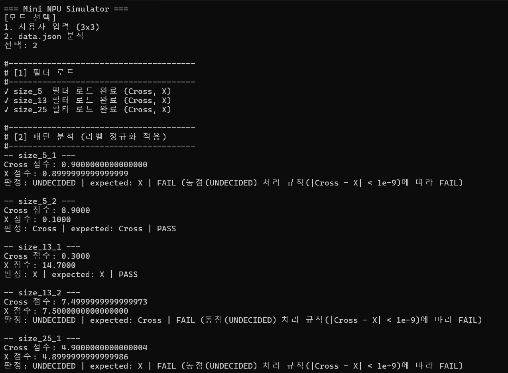
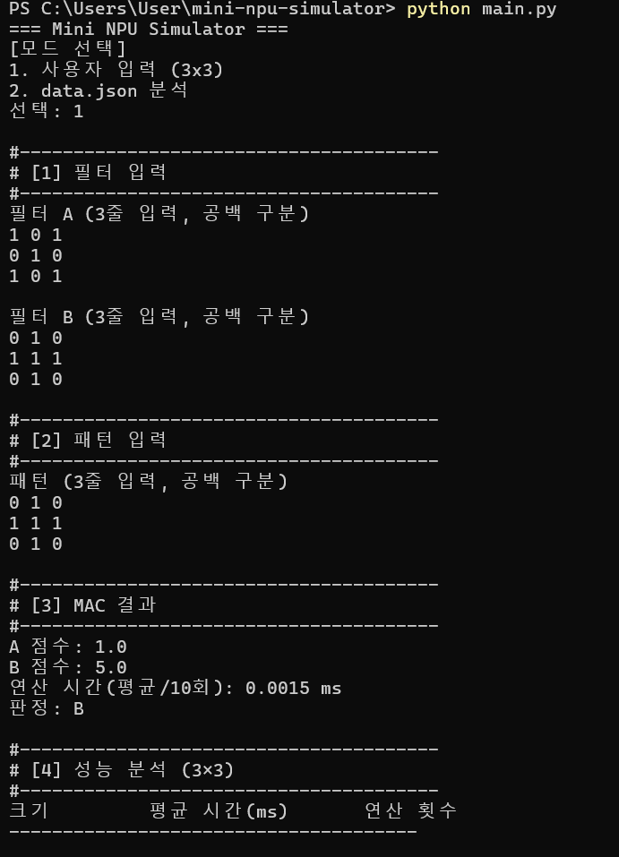

# Mini NPU Simulator

## 1. 실행 방법
- **실행 환경:** Python 3.8 이상 (NumPy, Pandas 등 외부 라이브러리 없이 표준 라이브러리 `json`, `time`만 사용)
- **파일 위치:** `main.py`와 `data.json` 파일을 동일한 폴더(디렉토리)에 위치시킵니다.
- **실행 명령어:** 터미널에서 아래 명령어를 입력해 프로그램을 실행합니다.
  ```powershell
   #작업할 폴더로 이동 (예: 바탕화면)
    cd ~/Desktop

    #저장소 내려받기 
    git clone https://github.com/lsoov/mini-npu-simulator.git

    #폴더로 들어가기
    cd mini-npu-simulator

    #프로그램 실행
    python main.py
    ```
    
- **모드 선택 안내:**
  - `1` 입력 시: 3×3 크기의 필터 A, B와 입력 패턴을 콘솔에서 공백으로 구분해 한 줄씩 직접 입력하여 MAC 연산 및 판정 수행
  - `2` 입력 시: `data.json` 파일을 자동으로 로드하여 5×5, 13×13, 25×25 크기별 패턴 일괄 검증 및 성능 분석 수행


  

  

---

## 2. 구현 요약

### 1) MAC 연산 원리 및 점수 해석 근거
- **구현 방식:** 외부 벡터화 라이브러리 없이 순수 파이썬 이중 `for`문을 활용하여 입력 패턴과 필터의 동일 위치 원소를 곱하고 누적 합산(`float`)하는 `calculate_mac()` 함수를 직접 구현했습니다.
- **점수 해석 근거 (유사도 비례 원리):** MAC 연산은 입력 패턴과 기준 필터의 각 위치 값을 곱해 더하는 내적(Inner Product) 기반 연산입니다. 필터의 가중치가 높은 영역(패턴의 핵심 특징 부위)과 입력 데이터의 활성 영역(`1.0`)이 정확히 겹칠수록 곱셈 결과가 양수로 누적되어 총점이 높아지므로, **MAC 점수가 높을수록 입력 패턴이 해당 필터의 형태와 더 유사함**을 의미합니다.
  - 예: 3×3 십자가 입력(`1`이 5개)을 십자가 필터와 연산하면 5개 위치가 모두 일치해 `5.0`점을 얻지만, X 필터와 연산하면 중앙 1개만 일치해 `1.0`점에 그칩니다.

### 2) 라벨 정규화(표준화) 및 새 라벨 확장 절차
- **표준화 방식:** `data.json` 내부에서 혼용되는 필터 키(`cross`, `x`)와 정답 라벨(`+`, `x`)을 `normalize_label()` 함수로 분리·모듈화하여 프로그램 내부 표준 라벨인 `Cross`와 `X`로 통일했습니다.
- **새 라벨(예: 원형 `Circle` 또는 대각선 `Slash`) 추가 시 확장 절차:**
  1. **정규화 규칙 확장:** `normalize_label()` 함수의 조건문에 신규 표기법 매핑 규칙을 추가합니다 (예: `'o'`, `'circle'` → `'Circle'`).
  2. **필터 데이터 등록:** `data.json`의 `filters` 내 각 크기(`size_5`, `size_13`, `size_25`) 객체에 신규 필터 키와 2차원 가중치 배열을 추가합니다.
  3. **테스트 패턴 추가 및 검증:** `data.json`의 `patterns`에 신규 패턴 입력과 `expected` 라벨을 등록하고, 판정 분기 로직에 신규 표준 라벨 비교 후보를 포함해 일괄 검증합니다.

### 3) 동점 비교 정책 (Epsilon) 및 모드별 차이
- **허용오차(`1e-9`) 선정 근거:** IEEE 754 배정밀도 부동소수점(`float64`)의 유효숫자 한계(약 $10^{-16}$)와 수백 회 누적 연산 시 발생할 수 있는 최대 반올림 오차 범위를 여유 있게 포괄하면서도, 의도된 가중치 차이는 훼손하지 않는 임계값으로 `1e-9`를 적용했습니다.
- **모드별 동점 출력 차이:**

| 구분 | 동점 조건 | 판정 출력 | 후속 처리 |
| :--- | :--- | :--- | :--- |
| **모드 1 (사용자 입력)** | `|A - B| < 1e-9` | `판정 불가 (|A-B| < 1e-9)` | 콘솔 안내 출력 후 종료 |
| **모드 2 (`data.json` 분석)** | `|Cross - X| < 1e-9` | `UNDECIDED` | 정답(`Cross`/`X`)과 불일치하므로 `FAIL`로 집계 |

---

## 3. 결과 리포트

### 1) 실패 케이스 및 원인 분석
`data.json` 내 전체 6개 테스트 케이스(`size_5_1` ~ `size_25_2`)를 분석한 결과, **총 6개 중 5개 PASS, 1개 FAIL**이 발생했습니다.
- **실패 케이스 식별자:** `size_5_1`
- **실패 원인 상세 분석 (로직 오류가 아닌 수치 비교 정책에 의한 정상 판정):**
  - `size_5_1`의 입력 패턴은 `X` 형태이지만, `size_5`의 `Cross` 필터 중앙에 `0.9`라는 높은 가중치가 부여되어 있어 `Cross` 필터와의 MAC 점수가 `0.9`로 산출됩니다.
  - 반면 `X` 필터는 대각선 9개 칸에 각각 `0.1`의 가중치를 가지고 있어 이론상 합계는 `0.9`이지만, 컴퓨터의 이진 부동소수점 연산 특성상 `0.1`을 9번 누적 합산하면 정확한 `0.9`가 아닌 `0.8999999999999999`로 계산됩니다.
  - 본 시뮬레이터는 `|Cross - X| < 1e-9` 허용오차(Epsilon) 비교 정책을 적용하여 두 점수의 미세한 부동소수점 차이를 동점(`UNDECIDED`)으로 정확히 판별해 냈으며, 이에 따라 기대 정답(`expected: X`)과 일치하지 않는 `FAIL` 케이스로 정상 분류되었습니다.

### 2) 크기별 성능 측정 및 시간 복잡도 분석 ($O(N^2)$)
화면 입출력(I/O) 및 파일 로드 시간을 제외하고, 순수 MAC 연산 함수(`calculate_mac`)의 실행 시간만 `time.perf_counter()`로 10회 반복 측정하여 평균값을 도출했습니다.

| 패턴/필터 크기 ($N \times N$) | 평균 연산 시간 (ms) | 총 MAC 연산 횟수 ($N^2$) |
| :---: | :---: | :---: |
| **3×3** | `0.0025`  | 9 |
| **5×5** | `0.0061`  | 25 |
| **13×13** | `0.0384`  | 169 |
| **25×25** | `0.1392`  | 625 |

- **시간 복잡도 $O(N^2)$ 근거:** MAC 연산은 가로 $N$, 세로 $N$ 크기의 2차원 배열 모든 원소를 한 번씩 순회하며 곱셈과 덧셈을 수행하는 이중 반복문 구조입니다. 따라서 한 변의 길이가 $N$일 때 수행되는 기본 연산 횟수는 정확히 $N \times N = N^2$번입니다.
- **측정 결과 해석:** 3×3(9회)에서 25×25(625회)로 입력 크기가 커질수록 연산 횟수가 69.4배 증가하며, 실제 측정 시간 역시 이에 비례하여 상승합니다(미세 편차는 파이썬 인터프리터 루프 오버헤드 및 CPU 캐시 적중률 차이에 기인함).

---

## 4. 대규모 연산(1000×1000) 최적화 및 CPU/NPU 병목 분석

### 1) 대규모 패턴(1000×1000) 처리 시 예상 문제 및 우선 최적화 방안
- **예상 문제:** 크기가 $1000 \times 1000$으로 커지면 단일 필터당 MAC 연산 횟수가 $1,000,000$($10^6$)회로 급증하며, 다수의 필터를 연속 처리할 경우 파이썬 순수 이중 반복문의 인터프리터 오버헤드와 2차원 리스트의 비연속적 메모리 참조(포인터 체이싱)로 인해 **캐시 미스(Cache Miss) 및 실행 시간 급증** 문제가 발생합니다.
- **우선 적용할 최적화 전략:**
  1. **메모리 레이아웃 평탄화 (1차원 연속 배열 변환):** 2차원 중첩 리스트(`matrix[i][j]`)를 길이 $N^2$의 1차원 배열(`flat[i * N + j]`)로 변환하여 메모리 지역성(Spatial Locality)을 높이고 캐시 효율을 극대화합니다.
  2. **타일링(블록화, Cache Blocking):** 1000×1000 전체 데이터를 한 번에 순회하는 대신 CPU L1/L2 캐시 크기에 맞는 작은 블록(예: 32×32 또는 64×64) 단위로 나누어 연산함으로써 메모리 대역폭 병목을 줄입니다.
  3. **자료형 경량화 및 양자화(Quantization):** 배정밀도 부동소수점(`float64`) 대신 단정밀도(`float32`) 또는 정수형(`int8`)으로 가중치를 양자화하여 메모리 점유율과 연산 비용을 대폭 절감합니다.

### 2) CPU 직렬 처리 vs NPU 병렬 처리 병목 비교
- **CPU 병목 발생 지점:** 범용 CPU는 복잡한 분기 예측과 순차적 명령어 처리(직렬 처리)에 최적화되어 있어 코어 수가 제한적입니다. 따라서 수백만 번의 단순 MAC 연산이 몰릴 때 **명령어 디코딩 오버헤드와 순차 실행 대기 시간(Compute & Memory Bandwidth Bottleneck)**이 심각한 병목으로 작용합니다.
- **NPU 병렬 처리 및 병목 해소 방안:** AI 전용 칩인 NPU는 수천 개의 MAC 연산기(PE, Processing Element)가 격자 형태로 배열된 **시스톨릭 어레이(Systolic Array) 및 SIMD 병렬 아키텍처**를 사용합니다. 입력 데이터와 필터 가중치를 한 번 메모리에 올린 뒤 인접 연산기 간 데이터를 직접 전달하며 수천 개의 곱셈·누산 연산을 단일 클럭 사이클에 동시 처리하므로, CPU의 직렬 연산 병목과 반복적인 메모리 접근 병목을 근본적으로 해소할 수 있습니다.
